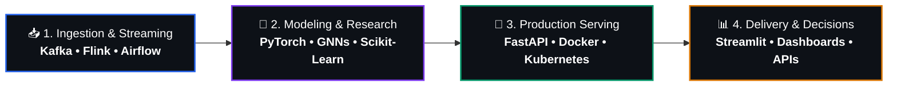
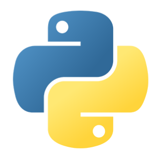
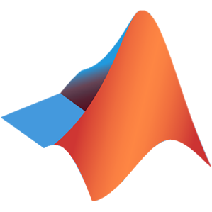
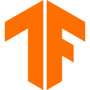
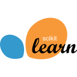
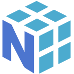
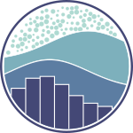
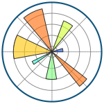
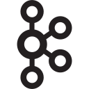
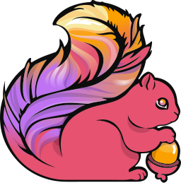

  

<h1 align="center">Md Nazmul Hasan Nihal</h1>

  

  <em>Architecting intelligent systems that transform complex, high-velocity data into explainable, production-ready decisions.</em>

  
  
  

---

## ⚡ Live GitHub Analytics

<table>
  <tr>
    <td width="50%" align="center">
      
    </td>
    <td width="50%" align="center">
      
    </td>
  </tr>
  <tr>
    <td width="50%" align="center">
      
    </td>
    <td width="50%" align="center">
      
    </td>
  </tr>
</table>

---

## 🔬 Core Competencies

<table>
  <tr>
    <td align="center" width="33%" valign="top">
      <h3>🤖 Data Science & Machine Learning</h3>
      
Exploratory data science, spatio-temporal graph neural networks (GNNs), interpretable machine learning, and quantum-inspired architectures engineered for reproducibility and scientific rigor.

    </td>
    <td align="center" width="33%" valign="top">
      <h3>⚡ Data Engineering & Streaming</h3>
      
High-throughput ingestion pipelines, real-time event streaming, stateful stream processing, and distributed transformations with Kafka, Flink, Spark, and modern lakehouses.

    </td>
    <td align="center" width="33%" valign="top">
      <h3>🚀 Full-Stack ML Delivery</h3>
      
Production REST/gRPC microservices, container orchestration, monitoring, and interactive analytical dashboards making complex intelligence accessible across organizations.

    </td>
  </tr>
</table>

---

## 🌟 Featured Engineering & Research

<table>
  <tr>
    <!-- Project 1 -->
    <td width="50%" valign="top">
      

        <h3><a href="https://github.com/NazmulHasanNihal/Intelligent-AML" target="_blank" rel="noopener noreferrer">🛡️ Intelligent-AML</a></h3>
        
<b>Risk-Controlled Spatio-Temporal Graph Learning for Anti-Money Laundering</b>

        

          <code>Dynamic Graph Networks</code> • <code>Anomaly Detection</code> • <code>PyTorch</code> • <code>FinTech</code>
        

        

          
          
          
          
        

      

      
Spatio-temporal graph representation learning pipeline modeling evolving financial transaction topologies to detect illicit laundering structures with rigorous risk guarantees.

    </td>
    <!-- Project 2 -->
    <td width="50%" valign="top">
      

        <h3><a href="https://github.com/NazmulHasanNihal/q-grax-dti" target="_blank" rel="noopener noreferrer">🧬 q-grax-dti</a></h3>
        
<b>Quantum-Inspired Graph Attention for Drug–Target Interaction & Affinity</b>

        

          <code>Quantum-Inspired AI</code> • <code>Graph Attention</code> • <code>Bioinformatics</code> • <code>DTI</code>
        

        

          
          
          
          
        

      

      
Cross-modal attention framework fusing molecular graph representations and protein sequences to predict binding affinities and discover therapeutic target interactions.

    </td>
  </tr>
  <tr>
    <!-- Project 3 -->
    <td width="50%" valign="top">
      

        <h3><a href="https://github.com/NazmulHasanNihal/SmartStream-A-Real-Time-IoT-Data-Engineering-Pipeline" target="_blank" rel="noopener noreferrer">⚡ SmartStream</a></h3>
        
<b>End-to-End Real-Time IoT Streaming Analytics & Live Dashboards</b>

        

          <code>Apache Kafka</code> • <code>Apache Flink</code> • <code>Docker</code> • <code>Stream Analytics</code>
        

        

          
          
          
          
        

      

      
Distributed real-time IoT event pipeline ingesting synthetic high-frequency sensor telemetry, windowed aggregation with Flink/Kafka, and live interactive monitoring.

    </td>
    <!-- Project 4 -->
    <td width="50%" valign="top">
      

        <h3><a href="https://github.com/NazmulHasanNihal/employee_management_system" target="_blank" rel="noopener noreferrer">💼 Enterprise Operations Platform</a></h3>
        
<b>Full-Stack Enterprise Management, Payroll & Analytics System</b>

        

          <code>Django / FastAPI</code> • <code>PostgreSQL</code> • <code>Docker</code> • <code>RBAC</code>
        

        

          
          
          
          
        

      

      
Secure, scalable web application orchestrating employee lifecycle workflows, attendance tracking, automated payroll calculations, and departmental performance metrics.

    </td>
  </tr>
</table>

### 📂 More Open-Source Repositories

- [**Fake News Detection**](https://github.com/NazmulHasanNihal/Fake-News-Detection-Naive-Bayes-and-LinearSVC-Approaches) — High-precision NLP classification comparing LinearSVC, Naive Bayes, and statistical text representations.
- [**NoSQL Social Media Influence Analysis**](https://github.com/NazmulHasanNihal/NoSQL-Based-Real-Time-Social-Media-Engagement-Influence-Analysis) — Network analysis, sentiment evaluation, and graph-based engagement discovery using NoSQL databases.
- [**Marketing Campaign Performance Analysis**](https://github.com/NazmulHasanNihal/Marketing-Campaign-Performance-Analysis) — Multi-channel attribution modeling, KPI analytics, customer acquisition cost (CAC), and ROI evaluation.

---

## 🔄 End-to-End Delivery Architecture

---

## 🛠️ Technical Toolkit

### 💻 Languages & Querying

  &nbsp;&nbsp;
  &nbsp;&nbsp;
  &nbsp;&nbsp;
  &nbsp;&nbsp;
  &nbsp;&nbsp;
  &nbsp;&nbsp;
  &nbsp;&nbsp;
  

### 🧠 Machine Learning & Data Science

  &nbsp;&nbsp;
  &nbsp;&nbsp;
  &nbsp;&nbsp;
  &nbsp;&nbsp;
  &nbsp;&nbsp;
  &nbsp;&nbsp;
  &nbsp;&nbsp;
  &nbsp;&nbsp;
  &nbsp;&nbsp;
  &nbsp;&nbsp;
  &nbsp;&nbsp;
  &nbsp;&nbsp;
  &nbsp;&nbsp;
  

### 🌊 Big Data, Databases & Streaming

  &nbsp;&nbsp;
  &nbsp;&nbsp;
  &nbsp;&nbsp;
  &nbsp;&nbsp;
  &nbsp;&nbsp;
  &nbsp;&nbsp;
  &nbsp;&nbsp;
  &nbsp;&nbsp;
  &nbsp;&nbsp;
  &nbsp;&nbsp;
  &nbsp;&nbsp;
  &nbsp;&nbsp;
  

### ⚙️ Systems, Cloud & Deployment

  &nbsp;&nbsp;
  &nbsp;&nbsp;
  &nbsp;&nbsp;
  &nbsp;&nbsp;
  &nbsp;&nbsp;
  &nbsp;&nbsp;
  &nbsp;&nbsp;
  &nbsp;&nbsp;
  &nbsp;&nbsp;
  &nbsp;&nbsp;
  &nbsp;&nbsp;
  

### 📊 Business Intelligence & Analysis Tools

  &nbsp;&nbsp;
  &nbsp;&nbsp;
  &nbsp;&nbsp;
  &nbsp;&nbsp;
  &nbsp;&nbsp;
  &nbsp;&nbsp;
  &nbsp;&nbsp;
  

---

## 🎯 Current Endeavors & Collaboration

- 🔬 **Active Research**: Spatio-temporal graph neural networks for financial anomaly detection & quantum-inspired graph learning in bioinformatics.
- ⚡ **Engineering Focus**: High-throughput distributed data pipelines integrating Kafka, Flink, and Polars.
- 💬 **Ask Me About**: Dynamic GNNs, Drug–Target Affinity (DTI), distributed stream architectures, and building production ML services.
- 🤝 **Open To**: Full-Stack Data Scientist / ML Engineer roles, Research Collaborations, and Technical Consulting.

---

## 📬 Let's Connect

  
  
  
  
  
  
  

